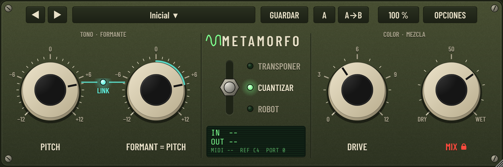

# Metamorfo

Manipulador monofónico de tono y formantes vocales: VST3, AU, CLAP y Standalone para Windows y macOS.
Su DAW principal es FL Studio.

> **Estado: versión 0.9.0. Las 7 fases están implementadas y verificadas automáticamente** (tests, validadores, sanitizers, auditoría DSP e instaladores en el CI). Falta la validación manual en FL Studio y en otros DAWs: ver [docs/ROADMAP.md](docs/ROADMAP.md) y [docs/DAW_MATRIX.md](docs/DAW_MATRIX.md).



- **Guía de usuario:** [docs/GUIA_USUARIO_es.md](docs/GUIA_USUARIO_es.md)
- Especificación: [docs/SPEC.md](docs/SPEC.md)
- Pruebas manuales en FL Studio: [docs/TESTING_FL.md](docs/TESTING_FL.md)
- Instrucciones para Claude Code: [CLAUDE.md](CLAUDE.md)

## Compilar

Necesitas:
- CMake 3.25 o superior
- Ninja
- Git
- un compilador C++20: Visual Studio 2022 o 2026 con "Desarrollo para el escritorio con C++" en Windows, o Xcode 15 o superior en macOS

Las dependencias (JUCE, CLAP y Catch2) se descargan solas en la primera configuración.

En Windows, abre **"Developer PowerShell for VS"** y ejecuta estos comandos en orden:

```powershell
cmake --preset release
```

```powershell
cmake --build --preset release
```

```powershell
ctest --preset release
```

En macOS se usan los mismos tres comandos en la Terminal.

Los plugins quedan en `build/release/Metamorfo_artefacts/Release/`, dentro de `VST3/`, `CLAP/`, `AU/` (solo en macOS) y `Standalone/`.

**Opcional:**
- Define la variable `CPM_SOURCE_CACHE` (por ejemplo `C:\cpm-cache`) para no volver a descargar las dependencias cada vez que borres `build/`.
- Si prefieres Visual Studio, `cmake --preset vs` genera una solución.

## Instaladores y binarios del CI

Cada push compila en GitHub Actions. Los binarios se descargan desde la pestaña **Actions**, abriendo la ejecución y bajando a **Artifacts**:
- `Metamorfo-win-Installer`: instalador de Windows (VST3 y CLAP en `C:\Program Files\Common Files`, más la aplicación).
- `Metamorfo-mac-Installer`: `.pkg` de macOS (VST3, AU y CLAP en `/Library/Audio/Plug-Ins`, más la aplicación).
- Los binarios sueltos por formato.
- En macOS los plugins tienen firma ad-hoc, sin notarizar. Después de descomprimir, quita la cuarentena:

```bash
xattr -dr com.apple.quarantine ~/Downloads/Metamorfo.vst3
```

- Aplica lo mismo a `Metamorfo.component` y `Metamorfo.clap`.

## Uso previsto

Metamorfo es para mezcla y producción. Tiene una **latencia fija de 33,4 ms** (1603 muestras a 48 kHz), que se informa al host para que la compense. Por eso no está pensado para monitoreo en vivo sin latencia.

## Licencia

[GNU AGPLv3](LICENSE.md). Las licencias de terceros están en [THIRD_PARTY_LICENSES.md](THIRD_PARTY_LICENSES.md).
